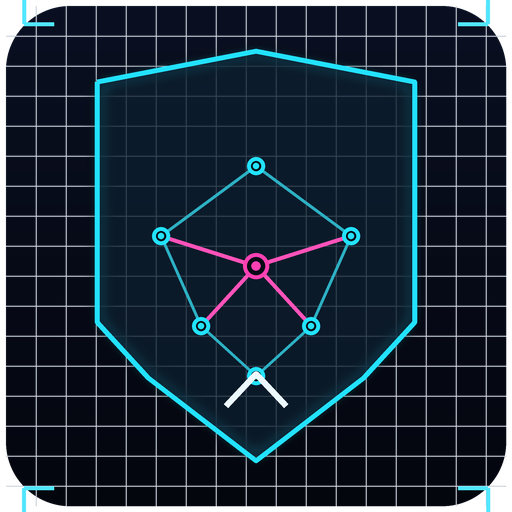

# AegisArena

AegisArena is a multiplayer tactical tournament and battle-resolution dapp built as a
GenLayer Intelligent Contract. Players compete in live, web-grounded tactical challenges,
GenLayer validators verify each outcome against real web sources using an LLM comparative
equivalence principle, and the community can endorse and discuss battles entirely on-chain.

- Live site: https://richeroveis.github.io/aegis-arena/
- Contract (studionet, chain id 61999): `0xb3aC20AC3d86eaa88f789F602dE709EfD3aaC0Cd`
- Explorer: https://explorer-studio.genlayer.com/address/0xb3aC20AC3d86eaa88f789F602dE709EfD3aaC0Cd
- Deploy tx: `0x6db4e0d330767739a2f81e0447b1143b4318ea303ca15910ab55716c1764e8fe`

The arena is already seeded on-chain with two active tournaments, ranked submissions, a
scored evaluation, a community endorsement from a second signer, and an on-chain comment,
so a reviewer opening the live site immediately sees a populated arena fetched from
studionet.

## Why GenLayer

AegisArena needs consensus for the part that is subjective and externally sourced: judging
whether a player's tactical submission is factually aligned with a live reference page. That
judgment determines scores, the tournament leader, and ultimately who receives the prize pool.
A plain backend could not make that decision in a way that is independently reproducible by
multiple validators. The deterministic parts (input validation, the mandatory-token gate, and
the structural score) run identically on every node; only the web-grounded quality judgment
goes through validator consensus.

## Architecture and boundaries

- Frontend owns: UI, burner/wallet auth, live reads, and non-authoritative pre-flight checks.
- Contract owns: tournament state, the deterministic score, the consensus-gated AI verdict,
  endorsements, comments, leaderboard points, and settlement of the prize to the leader.
- External sources own: the raw reference content, which validators re-fetch and normalize
  independently rather than trusting any player's claim.

## Contract

`contracts/aegis_arena.py`, pinned to the GenVM runner hash on line 1.

Persistent structures: `Tournament`, `BattleSubmission`, `ArenaComment`.

Write methods:

- `create_tournament(title, challenge_brief, reference_url, mandatory_fact_token, prize_pool_points)`
- `submit_tactic(tournament_id, moniker, tactic_payload)` (enforces the mandatory fact token and a deterministic 0..40 score)
- `evaluate_tactic_live(submission_id)` (validators fetch the reference URL and run `gl.eq_principle.prompt_comparative` for a 0..60 verdict)
- `score_tactic_deterministic(submission_id, rubric_bonus, rationale)` (creator or owner, exact-consensus fallback)
- `endorse_submission(submission_id)` (no self-endorsement, one per address, capped +2 bonus)
- `post_arena_comment(tournament_id, submission_id, author_moniker, message, stance)`
- `settle_tournament(tournament_id)` (creator or owner, pays the on-chain leader)
- `cancel_tournament(tournament_id)` (creator or owner, empty tournaments only)

View methods: `get_tournament`, `get_all_tournaments`, `get_tournament_submissions`,
`get_tournament_comments`, `get_leaderboard`, `get_arena_stats`.

## Scoring model

- Deterministic 0..40: mandatory-token emphasis, length efficiency, and structural richness.
- AI verdict 0..60: only through validator consensus on the live reference source.
- Total 0..100, clamped. Endorsements add a capped community bonus.

## Frontend

`frontend/` is a Vite + React + TypeScript app using `genlayer-js`.

- Dual wallet: a one-click burner identity persisted in localStorage, or a MetaMask / EIP-1193
  connection. A "New Burner Identity" button makes it easy to test multi-player endorsement.
- Live dashboard with on-chain stats, a network health indicator, and a contract badge linking
  to the explorer.
- Tournament explorer and live battle room with ranked submissions.
- Tactical submission console with a real-time pre-flight check (mandatory-token presence and
  character bounds) and a Quick Fill demo tactic.
- Per-submission "Trigger Live AI Consensus" and "Endorse" actions.
- On-chain discussion feed with stance badges and a comment composer.
- Create-tournament modal with a preset scenario loader.
- A live transaction lifecycle stepper: Signing, Broadcast to Studionet, Validator Consensus,
  Finalized with an explorer link, then automatic state refresh.

## Repository layout

```
contracts/aegis_arena.py        the Intelligent Contract
tests/test_aegis_arena_direct.py  50 direct-mode tests
tests/test_aegis_arena_integration.py  live studionet consensus tests
tests/conftest.py               Windows os.unlink shim for direct mode
scripts/deploy_studionet.py     deploy + seed + evidence collection
scripts/make_logo.py            programmatic logo renderer
evidence/studionet_deployment.json  on-chain deployment proof
docs/adversarial-review.md      security review notes
frontend/                        the live web app
```

## Development

```bash
pip install -r requirements.txt
genvm-lint check contracts/aegis_arena.py
pytest tests/ -q                 # offline direct suite (integration is skipped by default)

# live consensus suite (needs network to studionet)
RUN_STUDIONET_INTEGRATION=1 pytest tests/test_aegis_arena_integration.py -v -s

# deploy and seed a fresh instance
python scripts/deploy_studionet.py

# frontend
cd frontend && npm install && npm run build
```

## Security

See `docs/adversarial-review.md`. Highlights: strict input bounds with floors and ceilings,
rejection (not clamping) of out-of-range values, self-endorsement and duplicate-endorsement
guards, prompt-injection defusing of all fetched and creator-supplied text, single-shot
scoring, and settle/cancel guards that are mutually exclusive by status and entry count. The
non-custodial design means the contract holds no external funds; points are a reputation
ledger, and settlement transfers prize points to the on-chain leader only.

## Tech stack

GenLayer studionet, GenVM Python runner (pinned), `genlayer-js`, Vite, React, TypeScript,
viem, deployed to GitHub Pages.
